<p align="center">
  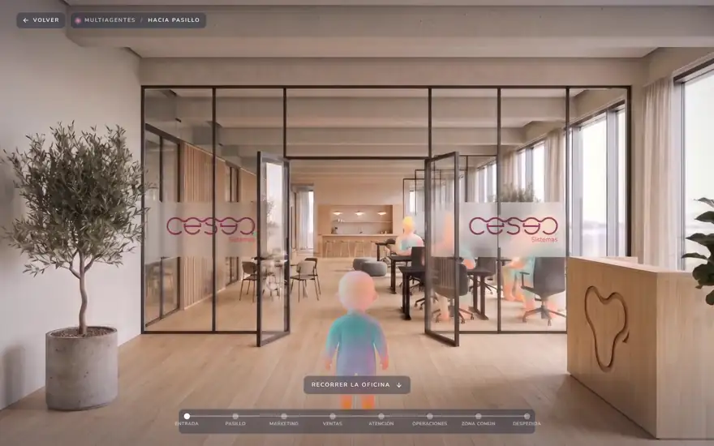
</p>
<p align="center">
  <a href="https://sistemascsa.com/multiagentes.html"><b>The Office</b></a> ·
  <a href="https://sistemascsa.com/webapps.html"><b>The City</b></a> ·
  <a href="#how-the-office-was-made">How it was made</a> ·
  <a href="#the-scroll-engine">Scroll engine</a> ·
  <a href="#every-screen">Every screen</a> ·
  <a href="#security--privacy">Security</a>
</p>
<p align="center">
  
  
  
  
  
  
  
  
</p>

# CESEA Sistemas — experiential website

Marketing site for a Spanish health-tech company that sells clinical software, AI services and custom development to dental clinics, care homes and medical centres. Two of its pages are not pages at all: they are **walk-throughs you drive with the scroll wheel** — a city and an office — where every frame of video moves only when you do, and a translucent mascot walks with the camera, turns to look at each team and, at the end, turns round and waves.

**Live:** https://sistemascsa.com · [The Office](https://sistemascsa.com/multiagentes.html) · [The City](https://sistemascsa.com/webapps.html) · [▶ full desktop tour, 30 s (MP4)](assets/office-tour.mp4)

The brief for the office was one sentence: make a business owner understand that the product *"is not a chatbot, it is a team of AI agents"*. So the page is an office you walk into. Each room holds one team — marketing, sales, support, operations — working at their desks; you stop in front of them, the mascot turns to look, and a card tells you what that team does. At the end everyone is on the sofa in the lounge, and the call to action is waiting there.

I designed and built the experience end to end: the visual bible, the production pipeline for every still and every clip, the post-production tools that make clips join without a seam, the scroll engine, the mascot layer, and the test rig that walks the tour in two browser engines and nineteen screen sizes. The rest of the site — tree homepage, product pages, quote builder, an Angular landing for one-off products — runs on the same no-build-step stack described [further down](#architecture).

---

## The Office

<table>
  <tr>
    <td width="50%" valign="top">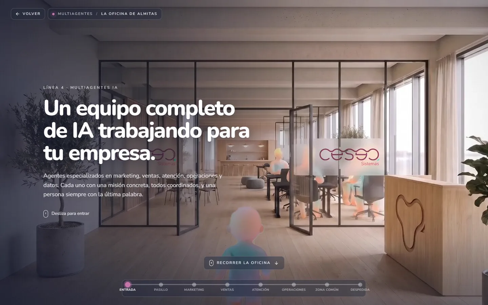<br><sub><b>Entrance.</b> The mascot walks in from behind the camera — large and cropped at first, scaled by perspective until she reaches her mark — and the headline fades as you start to scroll.</sub></td>
    <td width="50%" valign="top">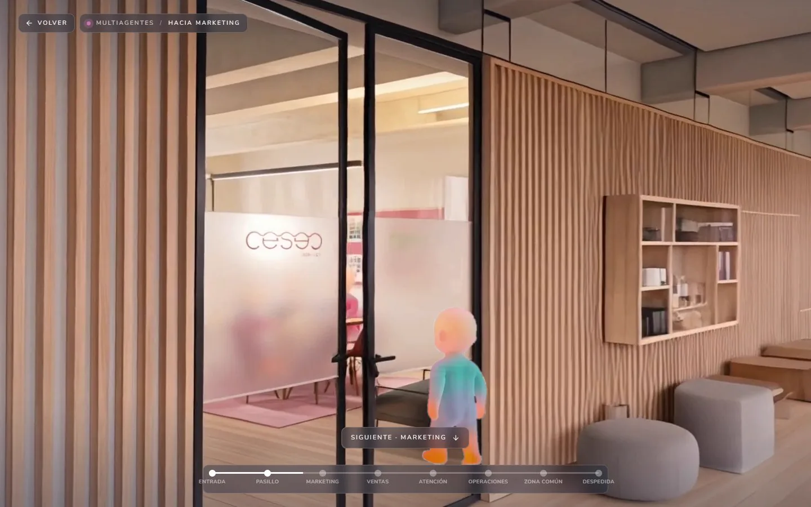<br><sub><b>A real turn.</b> No cut, no panel wiping the lens: the camera turns left at a real glass door in the slatted wall, and the marketing room is revealed behind it.</sub></td>
  </tr>
  <tr>
    <td width="50%" valign="top">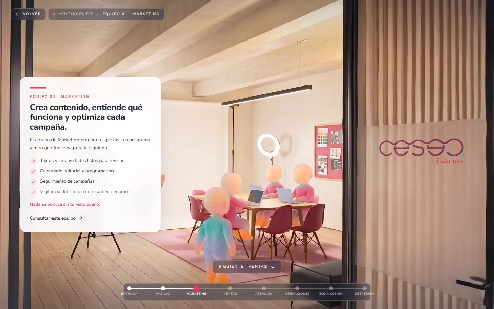<br><sub><b>Marketing.</b> Photo studio, the team at the pink table, the company logo on the glass. The card builds line by line as you keep scrolling.</sub></td>
    <td width="50%" valign="top">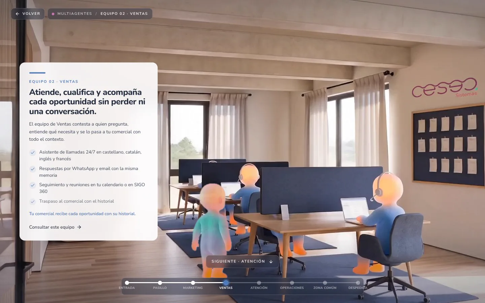<br><sub><b>Sales.</b> Each team's body colour is its brand colour; heads, hands and feet stay exactly the original character's.</sub></td>
  </tr>
  <tr>
    <td width="50%" valign="top">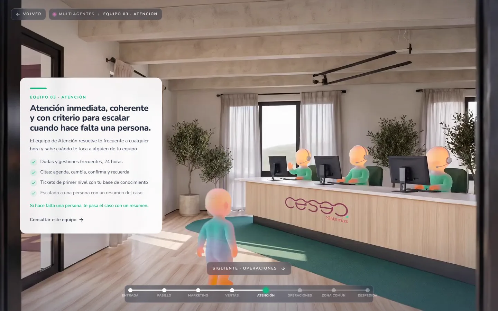<br><sub><b>Support.</b> Logo on the counter, composited from the real brand file so it is legible and correctly spelled in every frame.</sub></td>
    <td width="50%" valign="top">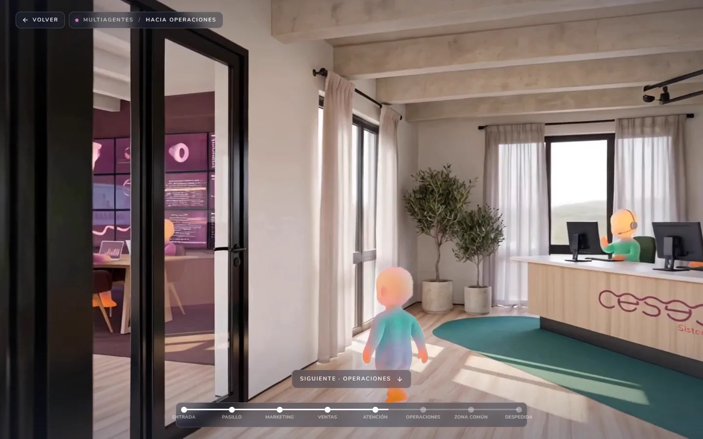<br><sub><b>Next door.</b> Operations was glimpsed through this glass door from the reception before you ever walk through it.</sub></td>
  </tr>
  <tr>
    <td width="50%" valign="top">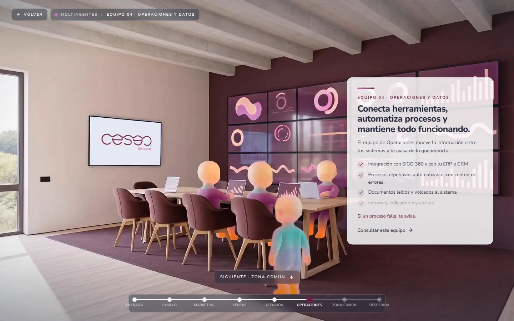<br><sub><b>Operations.</b> A wall of abstract dashboards — no numbers, no text, nothing that could read as a claim.</sub></td>
    <td width="50%" valign="top">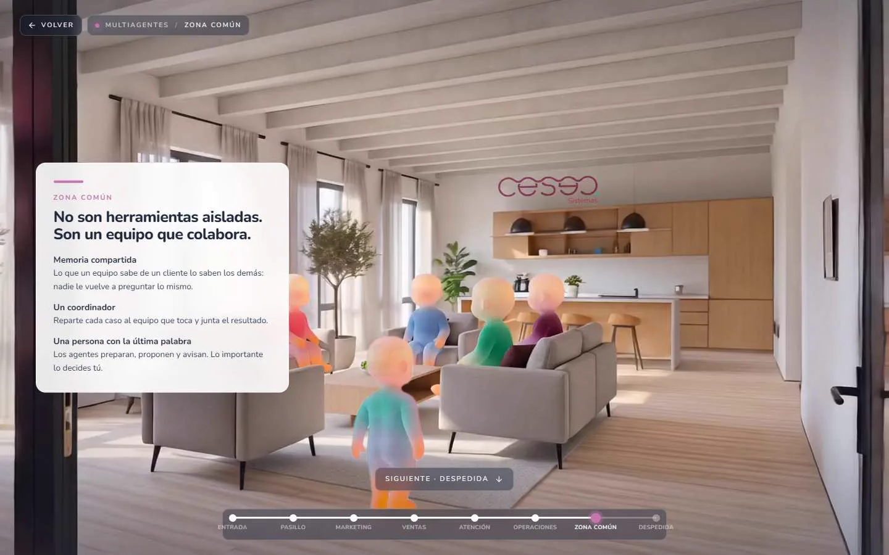<br><sub><b>The lounge.</b> One of each team on the sofas: shared memory, one coordinator, a person with the final say.</sub></td>
  </tr>
  <tr>
    <td width="50%" valign="top">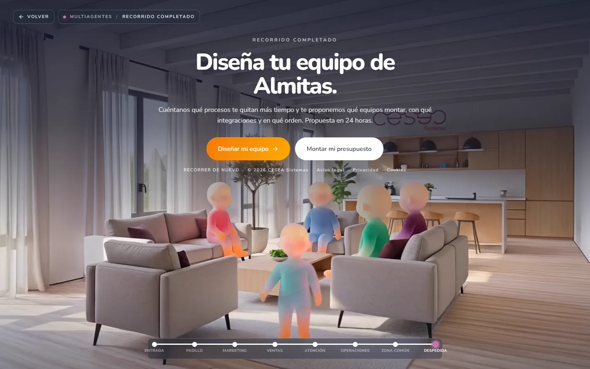<br><sub><b>Farewell.</b> The camera stops, the mascot turns round to face you and waves; the call to action, legal links and "walk it again" live inside the scene — the page has no footer.</sub></td>
    <td width="50%" valign="top">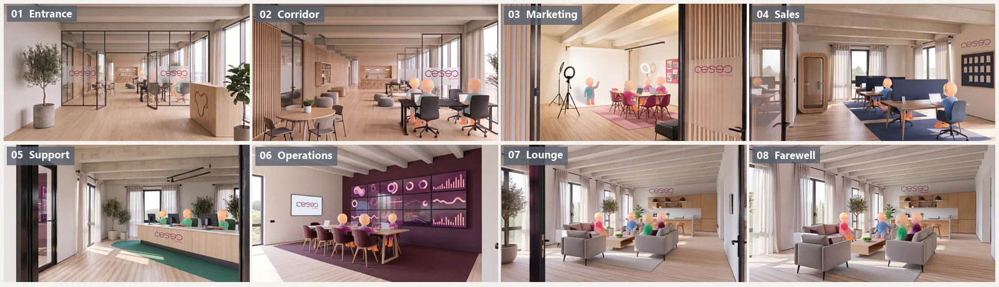<br><sub><b>Approved as stills first.</b> All eight rooms, signed off before a single second of video was generated. See below.</sub></td>
  </tr>
</table>

## How the Office was made

The hard part of a generated walk-through is not making one good clip. It is making thirty-five seconds of clips look like **one building, one light, one character** — and making every join invisible when the viewer can stop on any frame. I had already learned this the expensive way on the City (see [below](#the-city)), so the Office was planned as a production, not a prompt.

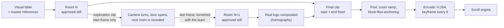

A few decisions explain most of the result.

**Stills before video, always.** Every room existed as an approved image — same ceiling beams, same oak floor, same 5,200 K late-morning light, same 24 mm camera at eye height — before any clip was made. A clip is only ever generated *between two approved stills*, so if one fails I regenerate that clip alone; its ends do not move and nothing downstream changes.

**Rooms are born from the walk, not drawn separately.** My first version of this office had beautiful rooms that were each composed on their own. They could not be joined: a camera cannot turn left out of one picture into another that shares no walls, and the video model "solves" it by morphing one room into the other. So each room was regenerated from a short exploration clip that starts on the previous approved room and actually walks through the door; the last frame of that walk — real geometry, real door, real window on the right side — is then furnished with that room's team and approved. Then the final clip is generated with both ends fixed. Every turn you see is a turn through space that exists.

**Occluders were the first answer and the wrong one.** An earlier version hid every room change behind a wall or panel sweeping across the lens. It worked technically and looked like a trick. Real turns replaced all of them.

**Logos are composited, never generated.** Image models misspell wordmarks. The real brand file is projected onto each surface — glass, wall, counter, screen — with a homography computed per surface and shaded by the light underneath it, *before* the clips are generated, so the logo moves with the camera like any other object in the room.

**Joins are anchored in post.** A generated clip lands close to its end still, not on it — typically 0.3 to 1.3 % too wide and a pixel or two off. Each clip gets a sub-pixel zoom ramp so its last frame matches the still's framing, then the remaining residual is measured with block matching and the last sixteen frames are warped towards the still. A plain cross-fade would double every piece of furniture still in motion. Both ends of every clip land at SSIM ≥ 0.97 against the stills the page shows when you stop.

**Every clip is reviewed before the next one is made.** Scene-cut detection, SSIM at both ends, frame-to-frame luminance jumps, a contact sheet every six frames and a look at the characters frame by frame. One clip was regenerated because the furniture melted mid-pan; one known flaw shipped: a studio lamp appears beside the slatted wall for under a second between marketing and sales.

## The mascot is a layer, not pixels in the video

<p align="center">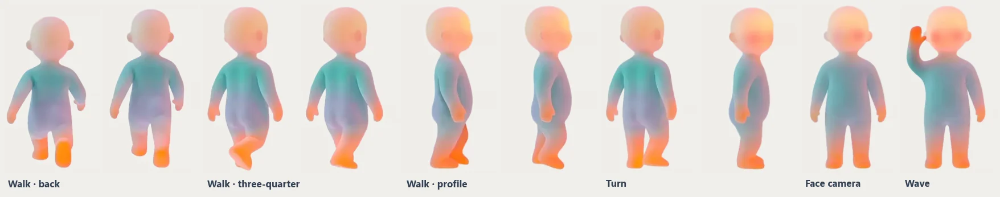</p>

If the mascot were part of the generated video, she would be redrawn in every clip — different proportions, hair appearing, a face where there must not be one. She is the client's character and has to be identical in every frame, so she is never generated inside a scene.

She is a `<canvas>` above the video, drawing frames from **six sequences with alpha**: walking from behind, at three-quarters and in profile, turning to profile, turning to face the camera, and waving. Each sequence was generated once on a flat background from the approved character sheet, checked frame by frame against the original art, cut out with a matte that keeps her frosted translucency, and re-graded so the head colour never drifts.

The scroll position decides everything:

- **Walking:** the cycle runs at a constant rate tied to the camera — start, a whole number of strides, stop — so she never moonwalks. Her direction follows the camera: from behind on straight runs, three-quarters (mirrored as needed) when it turns.
- **Stopping:** at each room she turns towards the team, holds while the card builds, and turns back the way she is about to walk, always passing through the back view so poses never jump.
- **The ending:** the camera stops in the lounge and she turns round — back, profile, front — then waves.
- **On a narrow phone:** the 16:9 frame is wider than the screen, so it pans to keep her in view and follows her gaze when she turns to a team.

## The scroll engine

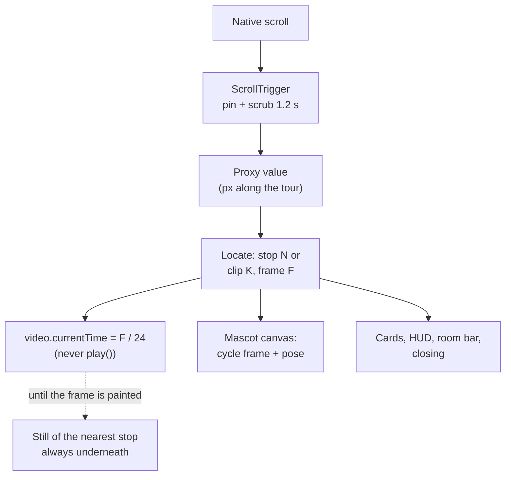

- **The scroll wheel moves frames; nothing ever plays.** Native scroll, the stage pinned with GSAP ScrollTrigger, and a scrubbed proxy that carries the position along the tour. Each clip is seeked to the exact frame with `currentTime`. Stop scrolling and the picture stops.
- **Encoded for seeking.** 1600×900 H.264 with a keyframe every six frames and no B-frames, so any seek decodes at most five frames. Seven clips, 847 frames, 18 MB for the whole tour.
- **The screen is never empty.** The still of the nearest room sits under the video at all times; a clip is only shown once it is painting the frame that was asked for.
- **Loading by priority.** The current clip first, then two ahead and one behind; distant ones are released. Safari does not report buffered ranges on a paused video, so nothing depends on `video.buffered`.
- **Safari and iOS:** no blobs, no autoplay. Videos are primed on the first touch. Every jump is verified, because WebKit sometimes drops the first one.
- **Reduced motion:** no video at all. Cross-fades between the stills and a still mascot.
- **Navigation:** a "Next · room" button and a clickable room bar; neighbouring rooms are reached by scrolling, distant ones by a jump. `#marketing`, `#ventas`… deep-link to a stop.
- **No scroll hijacking.** An earlier City engine captured the wheel and smoothed it in JavaScript; it felt like hitting speed bumps. Native scroll and a scrub of about a second fixed it.

## The City

<p align="center">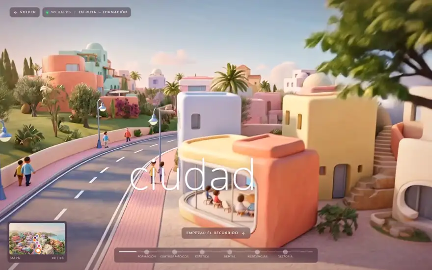</p>

The City came first: the custom web-apps page as a seaside town where each neighbourhood is a sector — training, medical centres, aesthetics, dental, care homes, business services — and the mascot walks from one to the next.

<table>
  <tr>
    <td width="33%" valign="top">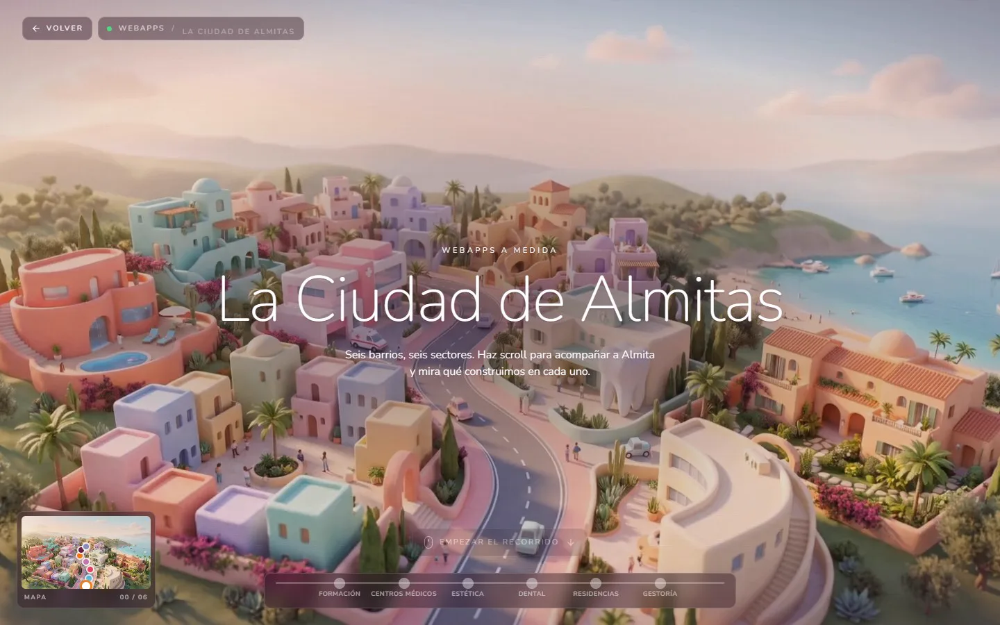<br><sub><b>Arrival.</b> Aerial view of the town before descending to street level.</sub></td>
    <td width="33%" valign="top">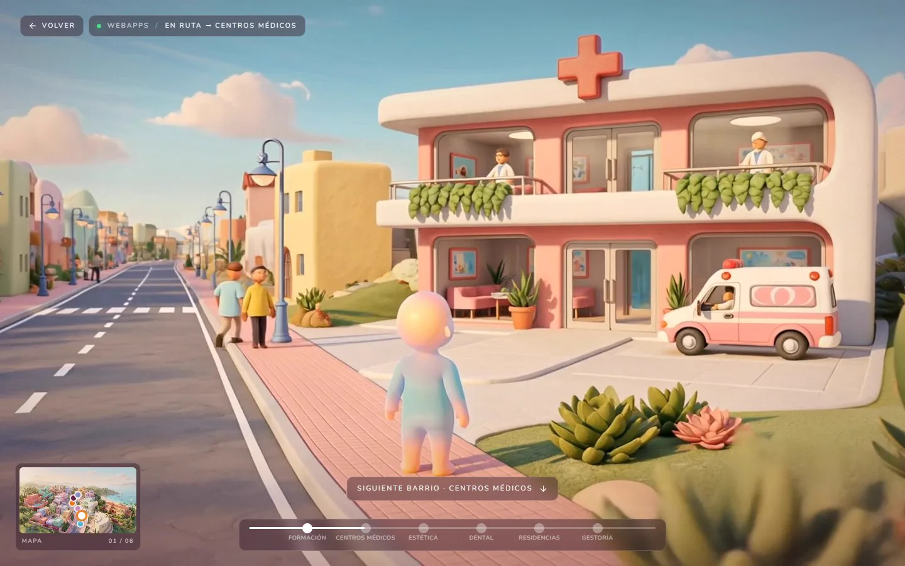<br><sub><b>On the way.</b> A minimap in the corner tracks the route.</sub></td>
    <td width="33%" valign="top">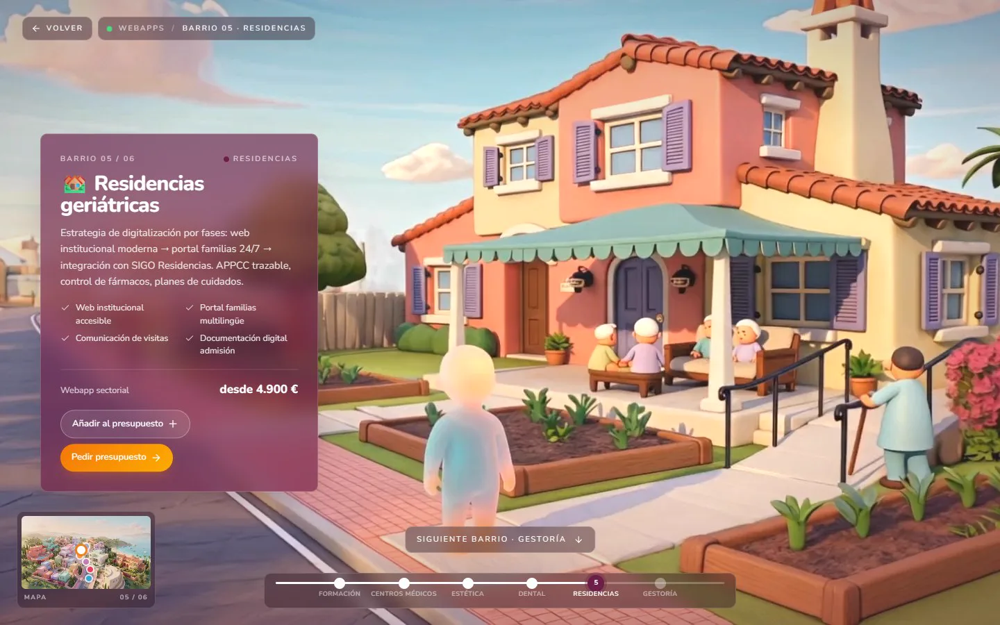<br><sub><b>A neighbourhood.</b> The card names the sector and opens the quote builder.</sub></td>
  </tr>
</table>

It is also the project that taught me how *not* to do this. Its clips were chained — the last frame of one clip became the start of the next — so every small reinterpretation was inherited and compounded. By the end the warm Mediterranean light had drifted towards midday blue and the character had lost some of her frosted look. The engine and the scroll feel are good; the imagery is visibly less consistent than the Office's. The Office's pipeline — approved stills first, every clip between two of them, nothing ever generated from a generated frame — exists because of this.

## Every screen

<p align="center">
  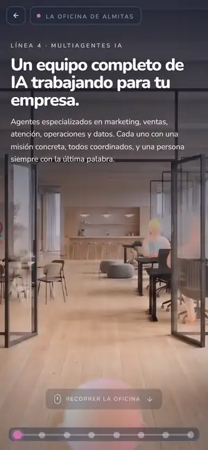
  &nbsp;&nbsp;
  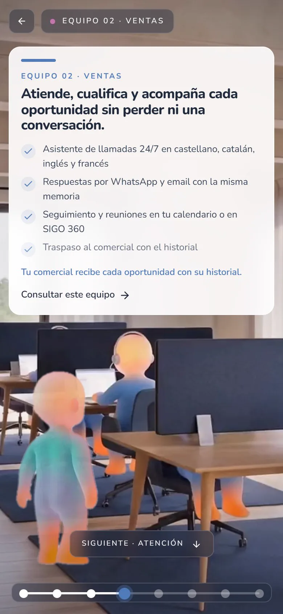
</p>
<p align="center">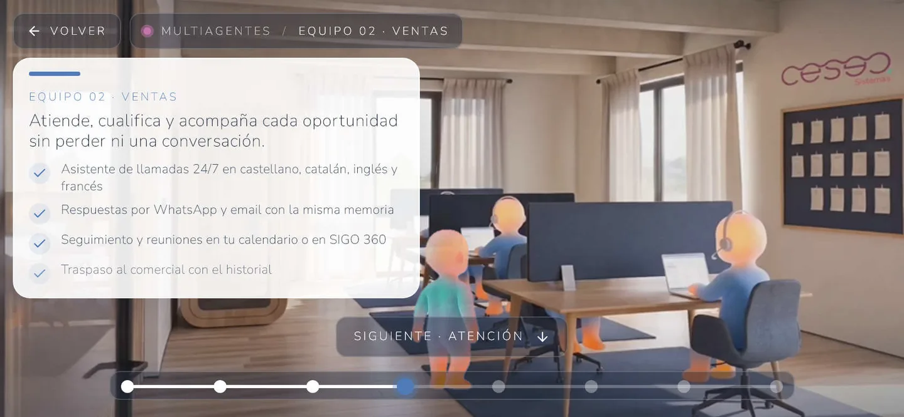</p>

The tour is video on phones too: the 16:9 frame covers the screen and pans to keep the mascot and the team in shot. In landscape on a phone the room card moves to one side and compacts so the room stays visible; on 2K, 4K and ultrawide monitors the whole interface layer scales as one so it does not shrink into a corner, and the frame shifts down rather than cropping the mascot's feet.

A Playwright rig checks it: the complete tour scrolled end to end in Chrome and WebKit — desktop, phone and reduced motion — plus five points of the tour at nineteen viewports, measuring horizontal overflow, cards overlapping the room bar or the "Next" button, the closing being cut off, and how much of the mascot is on screen.

| | Viewports |
|---|---|
| Phones, portrait | 320×568 · 360×740 · 390×844 · 430×932 |
| Phones, landscape | 844×390 · 932×430 |
| Tablets | 768×1024 · 820×1180 · 1024×1366 · 1024×768 · 1180×820 |
| Laptops and desktops | 1280×600 · 1280×720 · 1366×768 · 1440×900 · 1920×1080 · 2560×1440 |
| Ultrawide | 2560×1080 · 3440×1440 |

The images in this README come from the same rig: it forces every scroll position, waits until the video has painted the frame, and saves it, so recordings have no dropped frames.

## The rest of the site

<table>
  <tr>
    <td width="50%" valign="top">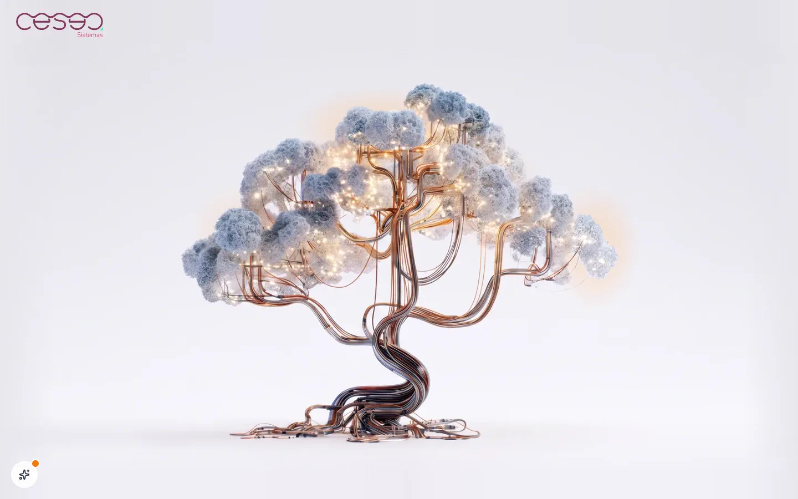<br><sub><b>Homepage.</b> A single illuminated tree whose leaves are the company's lines of business; names appear on hover, always visible on touch.</sub></td>
    <td width="50%" valign="top">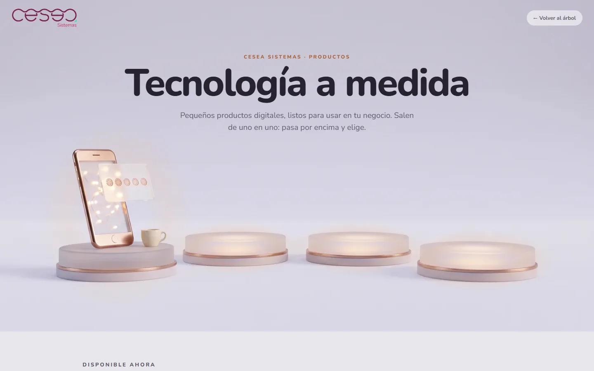<br><sub><b>Bespoke technology.</b> One-off digital products presented as small objects on plinths. The only Angular page on the site, pre-rendered to static files.</sub></td>
  </tr>
  <tr>
    <td width="50%" valign="top">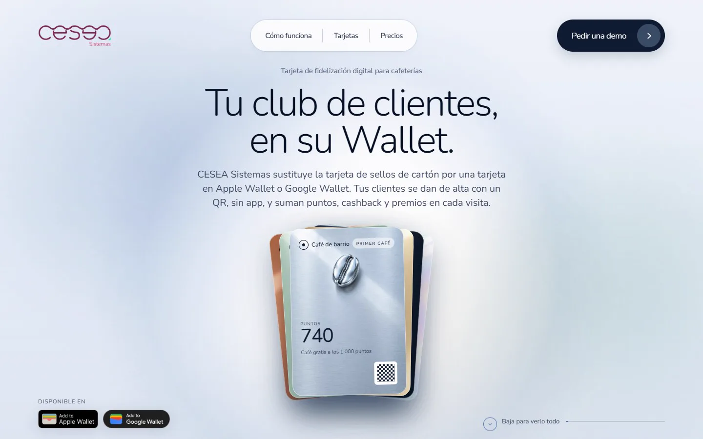<br><sub><b>Wallet loyalty cards.</b> A product page for cafés: stamp cards that live in Apple and Google Wallet, no app to install.</sub></td>
    <td width="50%" valign="top">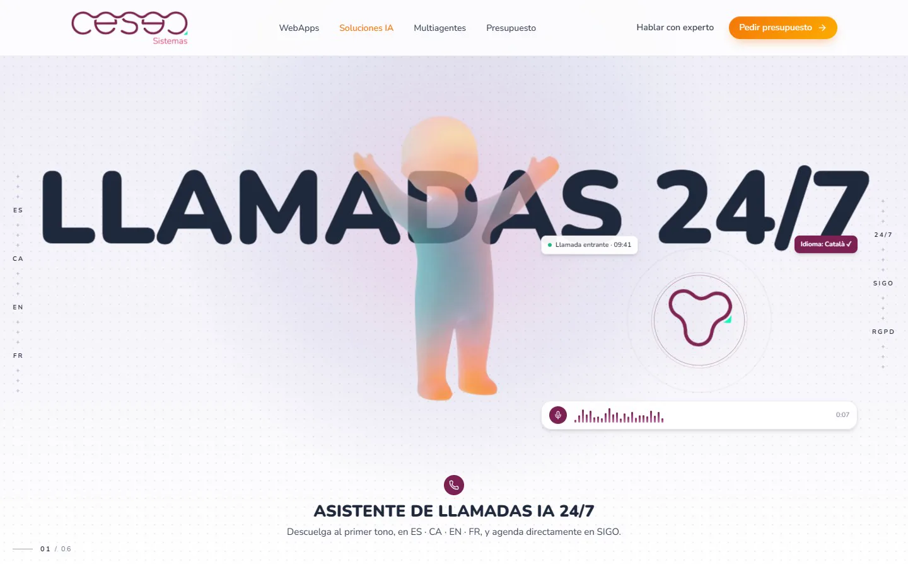<br><sub><b>AI landing.</b> A pinned hero where the display word rotates through six services in 3D while the character changes pose.</sub></td>
  </tr>
  <tr>
    <td width="50%" valign="top">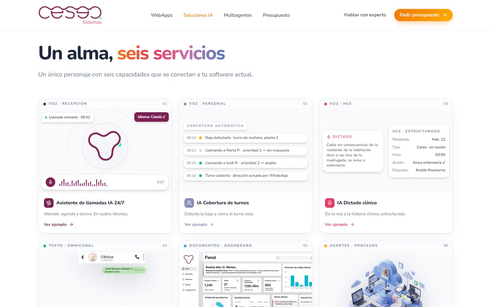<br><sub><b>Six services.</b> Each example opens full size and deep-links via <code>?ejemplo=</code>.</sub></td>
    <td width="50%" valign="top">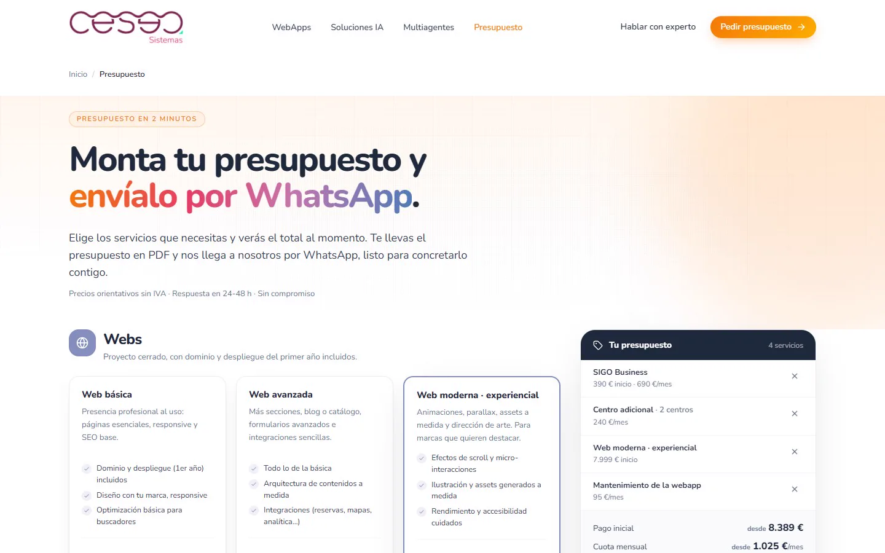<br><sub><b>Quote builder.</b> The full catalogue with published prices and a basket that follows the visitor across pages.</sub></td>
  </tr>
  <tr>
    <td width="50%" valign="top">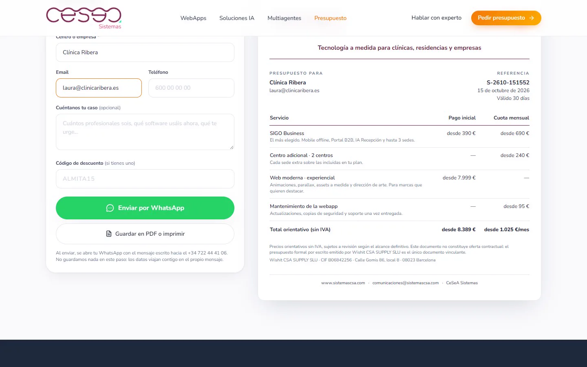<br><sub><b>The quote itself.</b> Rendered live on the company letterhead and printed as one exact A4 (invented client data).</sub></td>
    <td width="50%" valign="top">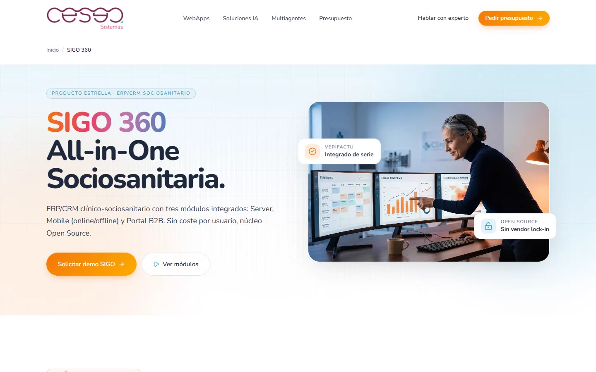<br><sub><b>SIGO 360.</b> The ERP/CRM for clinics and care homes, with its membership pricing.</sub></td>
  </tr>
</table>

## Stack

| Layer | Choice |
|---|---|
| Runtime | React 18 + ReactDOM from a CDN; JSX compiled in the browser by Babel standalone — no bundler |
| Scroll | GSAP 3.15 ScrollTrigger + ScrollToPlugin, loaded from cdnjs with SRI |
| Styling | Tailwind CSS via CDN with the brand palette in an inline config; Nunito throughout |
| Video | H.264 1600×900, CRF 23, `-g 6 -bf 0`, seeked with `currentTime`; WebP stills and mascot sequences with alpha |
| Imagery | Generated stills and clips (Nano Banana Pro, Kling 3.0) under a written visual bible; composited, graded and anchored with my own Node + ffmpeg tools |
| One landing | Angular 22, standalone components and signals, pre-rendered to static HTML |
| Testing | Playwright — Chrome and WebKit, 19 viewports, full-tour scroll runs, deterministic frame recorder |
| Backend | None on the site. Contact posts to a Supabase Edge Function; the quote goes out through WhatsApp |
| Delivery | GitHub Actions → `lftp` SFTP mirror → shared hosting behind a CDN |

## Architecture

**No build step, on purpose.** The client's hosting is a plain shared box, deployment is an SFTP mirror, and nobody on their side runs `npm`. Each page is a standalone HTML file with its own `<head>` (canonical, Open Graph, JSON-LD) that loads React, Babel and Tailwind from a CDN; shared components register on `window` and the page's app file composes them. Load order in the HTML is the dependency graph. It is not what I would pick for a product; it is the right call for a marketing site a non-technical team has to keep alive for years.

**The experiences are pages, not overlays.** The City and the Office have no navigation bar and no footer: back button and status top-left, room bar at the bottom, call to action and legal links inside the final scene. Media lives under versioned folders (`…/oficina/v2/`) because the host serves video as immutable for a year — a re-encode ships under a new path, never over the old one.

**One Angular island.** The bespoke-technology landing is the only place where a framework build earns its keep; it is pre-rendered to static files and copied into the site, so the host still only ever sees HTML.

**Icons without the flicker.** Lucide's `createIcons()` rewrites the DOM behind React's back, so icons vanished on re-render. The wrapper renders Lucide's SVG data as React elements instead.

## The quote builder

- **One source of prices.** The catalogue mirrors the public rate card: one-off, monthly, usage-based. Totals never merge them — usage is listed, never summed.
- **Mutually exclusive families.** A second ERP tier replaces the first instead of stacking two memberships.
- **A basket that follows you,** in `localStorage` behind a custom event, with a floating summary on every page.
- **Two exits, one document.** The quote renders on the real letterhead and prints as a single exact A4 (rendered a second time through a portal outside `#root`, so print CSS can show only that copy). The same data goes to the sales rep's WhatsApp through a `wa.me` deep link.

## SEO & structured data

A page that is a video is invisible to a crawler, so each experience carries an off-screen static summary of everything the tour says — teams, capabilities, FAQ — and JSON-LD that only declares what the page really shows; the Office has no prices anywhere, by the client's decision, and none in its markup either. The site ships `llms.txt` and `llms-full.txt` for answer engines, a hand-kept sitemap and a public glossary. The Open Graph image of the Office is the farewell frame, composed in the build script.

## Security & privacy

- **Headers and CSP** on every page, sources pinned to self and the CDNs actually used; `Permissions-Policy` denies camera, microphone, geolocation and payment.
- **All media self-hosted.** No third-party video player, no embeds, no trackers watching the tour.
- **No personal data at rest in the quote flow.** The basket stores only service IDs in the visitor's own browser; name and contact go straight into the WhatsApp message.
- **Analytics without cookies.**
- **Screenshots in this repository** use invented client data.

Known and tracked: the CSP allows `'unsafe-inline'` and `'unsafe-eval'`, which in-browser Babel requires — the price of the no-build constraint, and the reason this approach stays on marketing pages.

## Performance & accessibility

- **First load:** the first room's still and the first clip. Other clips arrive by priority as you move; you never wait on the whole 18 MB.
- **Seeking:** with a keyframe every six frames a seek costs a few milliseconds in Chrome, against tens with a default GOP.
- **Motion and keyboard:** `prefers-reduced-motion` removes video and animation. The tour can be walked with the keyboard and the "Next" button as well as the wheel.
- **Readable structure:** every experience has a real, visually hidden `<h1>`, a live status region announcing the current room, and labelled controls.

## What is still open

- **The host's CDN caches every variant of a page for a year,** compressed and uncompressed separately. After a deploy it has to be purged by hand, and a check without `--compressed` can report the new page while browsers still get the old one. Fixing the cache policy is with the hosting provider.
- **The City's imagery** is less consistent than the Office's, for the reasons above. Rebuilding it with the Office pipeline is a decision for the client.
- **Real-device Safari.** WebKit passes in automation; a run on a physical iPhone and Mac is still on the list.

## Repository layout

```
.
├── README.md        this case study
├── assets/          production captures: stills (WebP, 1440 px), animated tours (WebP), full tour (MP4)
├── LICENSE          all rights reserved — no application source is included
└── SECURITY.md      how to report something sensitive in this repository
```

---

Designed and built by **Daniel Brosed** — developer and security auditor.
[danielbrosed.com](https://danielbrosed.com) · [LinkedIn](https://www.linkedin.com/in/danielbrosed/)

The site and its content are © CESEA Sistemas / Wishit CSA SUPPLY SLU. This repository documents the build as a portfolio case study; the images are captures of the production site and the application source is not included. See [`LICENSE`](LICENSE).
